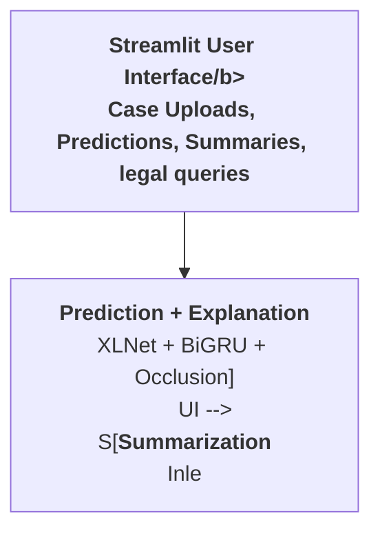

"During my undergraduate studies at PES University, I worked on a research project titled _Automating Court Judgement Prediction and Explanation for Indian Legal Cases_. The work was also published as a research paper at ICDSA 2025.

The motivation came from the complexity and volume of legal documents in the Indian judicial system.

Legal professionals often need to analyze lengthy judgments, understand the reasoning behind previous cases, and identify relevant legal provisions. This can be extremely time-consuming when documents span hundreds of pages.

We wanted to explore whether natural language processing and machine learning could assist with these activities.

Instead of building just a single prediction model, we designed a unified legal-assistance system with three major capabilities.

The first predicts whether a case petition is likely to be accepted or rejected and identifies portions of the document that influenced the prediction.

The second summarizes lengthy legal judgments so users can understand the main information more quickly.

The third is a legal chatbot that answers questions using Indian legal sources.

Our goal was not to replace judges or lawyers, but to develop a research prototype that could assist legal analysis and improve access to information."

## **Part 2 — Overall system architecture**

1:00–2:00

"We divided the project into three modules, each using a different NLP approach suited to its task.

For judgment prediction, we combined XLNet with a Bidirectional Gated Recurrent Unit network, or BiGRU, and an attention mechanism.

For summarization, we used InLegalBERT, a language model adapted to Indian legal text, along with sentence similarity and ranking.

For the chatbot, we implemented Retrieval-Augmented Generation, or RAG, using LangChain, FAISS, and Mistral-7B.

We integrated the modules through a Streamlit web interface, where users could upload documents, view predictions and explanations, generate summaries, or ask legal questions.

A key architectural decision was not to use one model for everything. Each module had different requirements: prediction needed classification, summarization needed identification of important content, and the chatbot needed retrieval and natural-language generation."

## **Part 3 — Judgment prediction using XLNet + BiGRU**

2:00–4:15

"The most technically involved module was judgment prediction.

We used the Indian Legal Documents Corpus, or ILDC, containing approximately 35,000 Indian legal cases.

The dataset contains case text and a binary outcome label, where 1 represents an accepted petition and 0 represents a rejected petition.

The major challenge was the length of the documents.

Transformer models have limitations on the length of input sequences they can process at once. Legal cases can contain thousands of tokens, so passing the entire document directly into XLNet wasn't practical.

To address this, we used a hierarchical architecture.

First, we tokenized the documents using the XLNet tokenizer and divided them into chunks of 512 tokens, including special tokens. We used a 100-token overlap between consecutive chunks to reduce the risk of losing context at chunk boundaries.

Each chunk was passed through XLNet, which generated contextual embeddings representing the meaning of that portion of the document.

We extracted hidden-state representations from the final four XLNet layers and combined them into a higher-dimensional representation.

These embeddings then served as input to the second level, a BiGRU network.

A BiGRU processes a sequence in both forward and backward directions. This is useful because the meaning of a section of legal text may depend on information that appears before or after it.

We also used an attention mechanism to help the model assign greater importance to more relevant portions of the input.

After the BiGRU and attention layers, the network passed the representation through dense layers to produce a final probability using a sigmoid activation function.

We used a threshold of 0.5 to determine the classification.

If the output was above 0.5, the case was classified as accepted; otherwise, it was classified as rejected.

By combining XLNet's contextual text representations with BiGRU's sequential modeling, we aimed to capture information from long documents more effectively than with a basic single-stage text classifier.

The resulting model achieved 73.74% accuracy on our reported evaluation, outperforming the baseline models included in our experiments."

### **How the prediction pipeline works**

![[Pasted image 20261118131620.png]]

## **Part 4 — Explainability using occlusion**

4:15–5:15

"Prediction accuracy alone wasn't enough for our application. In a legal context, users also need to understand which information influenced a prediction.

We therefore implemented an occlusion-based explanation method.

The basic idea is to measure how much the model's prediction changes when we temporarily hide a portion of the input.

We first run the model on the complete document and record its prediction probability.
[]
Then we mask one chunk of the document and run the prediction again.

If hiding that chunk causes a significant change in the probability, it suggests that the chunk was influential.

We repeat this process for the different chunks and rank them by their influence.

Then, within the most influential chunks, we repeat the masking process at the sentence level.

Finally, we extract the top-ranked sentences and present them as an explanation for the prediction.

For example, if masking a sentence discussing a crucial piece of evidence substantially reduces the model's confidence, that sentence may be important to the model's decision.

The advantage of this approach is that the explanation is tied to observable changes in model behavior rather than being an entirely separate generated justification.

However, an important limitation is that these sentences explain the model's behavior, not necessarily the true legal reasoning that a judge would use."

## **Part 5 — Document summarization with InLegalBERT**

5:15–6:45

"The second module focused on summarizing lengthy legal judgments.

We used InLegalBERT because it was designed for Indian legal language and had been trained on legal-domain tasks.

Our approach was based on extracting important sentences rather than generating an entirely new summary from scratch.

The first step was preprocessing the uploaded document. We extracted the text, divided it into sentences, and normalized the content while preserving important legal terminology.

We then used InLegalBERT to represent the sentences as numerical embeddings.

To determine which sentences were most representative of the document, we calculated cosine similarity between sentence embeddings.

Cosine similarity measures how similar two vectors are in direction. In this context, it helps identify sentences discussing related legal concepts.

We constructed a similarity matrix and calculated a ranking score for each sentence based on its similarity to other sentences.

Sentences with higher scores were considered more representative of the document's central content.

We selected the top-ranked portion, approximately 20% of the sentences according to our methodology, and arranged them in their original order to produce a readable summary.

For evaluation, we compared the generated summaries against reference headnotes from the original judgments.

We used ROUGE metrics, which measure text overlap between generated and reference summaries.

The reported ROUGE-L F1 score was 0.5184. We also evaluated 15 case files against a ROUGE-L F1 threshold of 0.4, and 13 exceeded that threshold.

This helped us assess whether the summarizer preserved important content, although a higher ROUGE score doesn't necessarily guarantee that every legally important detail has been retained."

**Summarization pipeline**

![[Pasted image 20261118131715.png]]

## **Part 6 — Legal chatbot using RAG, FAISS, and Mistral-7B**

6:45–8:15

"The third module was a legal chatbot designed to answer questions from both general users and legal professionals.

We wanted the system to answer questions using relevant Indian legal texts instead of relying exclusively on the language model's pretrained knowledge.

For that reason, we used Retrieval-Augmented Generation, or RAG.

We collected legal reference material from the Indian Penal Code, the Constitution of India, and the Bharatiya Nyaya Sanhita.

We divided these documents into chunks of approximately 1,024 characters with a 200-character overlap to preserve context around chunk boundaries.

We then converted the chunks into vector embeddings and stored them in FAISS, a similarity-search library.

When a user asked a question, we converted the question into an embedding and searched FAISS for the most relevant legal text chunks.

The top retrieved passages were combined with the question and supplied to Mistral-7B-Instruct to generate a response.

We used LangChain to organize document processing, retrieval, and model integration.

We also designed the chatbot to produce different levels of explanation depending on the user's needs.

For example, someone asking a simple question about a rental dispute might receive a straightforward explanation in everyday language.

A legal professional asking about a particular constitutional article could receive a more technical explanation involving statutory provisions.

We used 4-bit quantization for Mistral-7B to reduce memory requirements during inference.

The key benefit of RAG is that it provides the model with relevant source information at query time instead of relying entirely on what the model remembers.

However, retrieval doesn't guarantee correctness. The system can retrieve irrelevant passages or generate unsupported interpretations, so legal responses still require verification against authoritative sources."

![[Pasted image 20261118131820.png]]

## **Part 7 — Results and evaluation**

8:15–9:00

"We evaluated the three modules using different criteria.

For judgment prediction, we measured classification accuracy against the case labels in the ILDC test set.

Our XLNet and BiGRU architecture achieved 73.74% accuracy, compared with 67.03% for RoBERTa, 63.13% for DeBERTa, and 61.29% for ALBERT in our reported experiments.

For summarization, we measured ROUGE-1, ROUGE-2, and ROUGE-L scores against reference summaries.

Our reported InLegalBERT ROUGE-L F1 score was 0.5184. Additionally, 13 out of 15 evaluated summaries exceeded our selected threshold.

For the chatbot, the paper presents qualitative relevance assessments for different types of legal questions.

These experiments showed promising results for the research prototype, although the evaluation was not comprehensive enough to establish suitability for real-world legal decision-making."